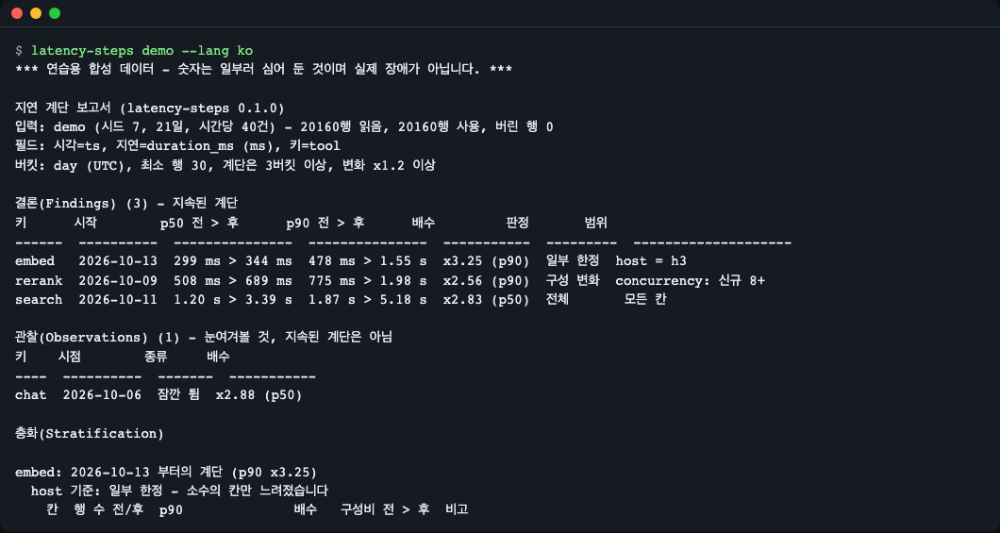
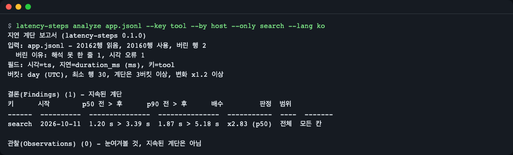
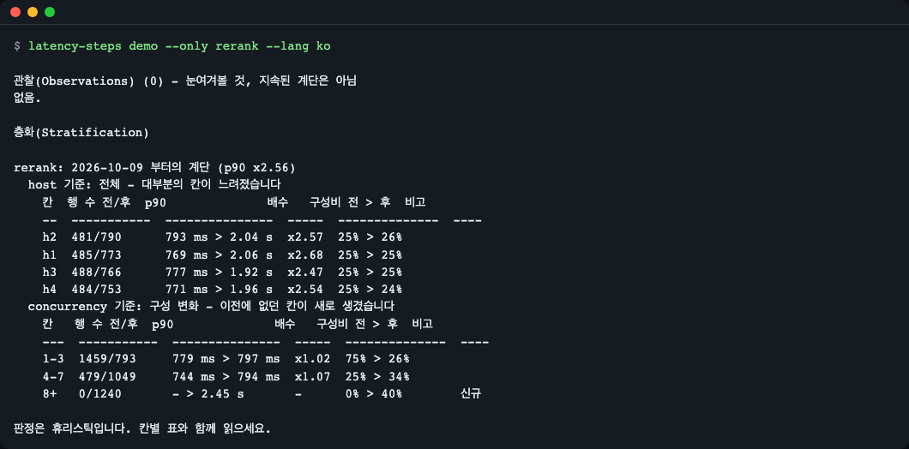
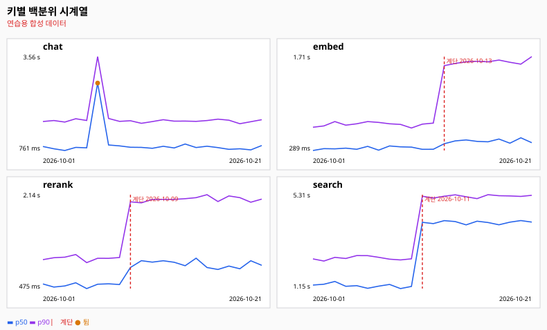
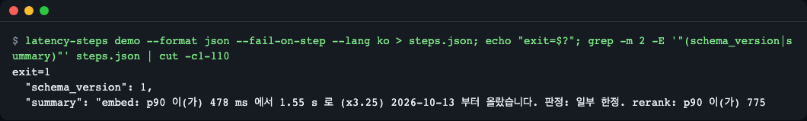
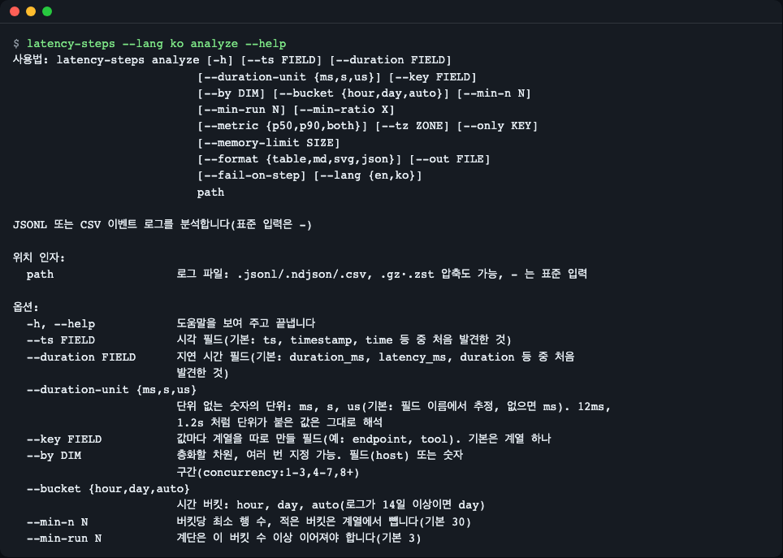
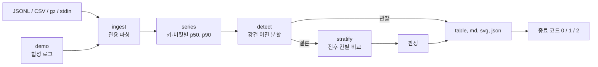

# latency-steps

[English](README.md) | **한국어**

"요즘 느려졌어요"라는 말을 들었을 때 쓰는 도구입니다. `latency-steps` 는 JSONL·CSV 이벤트 로그를 오프라인으로 읽어, 키(도구·엔드포인트·모델)별로 **언제부터** 지연이 계단처럼 올랐는지, 그 계단이 **한 호스트** 때문인지 **부하 구성 변화** 때문인지 **전체** 문제인지 알려 줍니다. DuckDB 로 p50/p90 시계열을 만들고, 순수 파이썬 변화점 탐지로 지속된 계단을 찾은 뒤, 계단 전후 구간을 직접 지정한 차원으로 나눠 비교합니다.


*내장 연습용 합성 로그에 명령 하나: 지속된 계단 3건(결론)과 하루짜리 튐 1건(관찰).*

## 이런 분께
- 백엔드나 에이전트를 운영하고, 도구 호출·API·모델 응답 로그를 파일로 갖고 있으며 "지난주부터 느린 것 같다"는 말을 듣는 분.
- 회의 전에 느려진 원인이 나쁜 호스트인지, 들어오는 트래픽 종류의 변화인지, 전체 변화인지 가르고 싶은 분.
- 새 지연 계단이 생기면 실패하는 야간 CI 작업을 만들고 싶은 분.

## 설치

Python 3.11 이상(DuckDB 2.0 요구)과 [uv](https://docs.astral.sh/uv/)가 필요합니다.

```bash
curl -LsSf https://astral.sh/uv/install.sh | sh     # uv 설치 (macOS / Linux)
git clone https://github.com/LeeGyeongPil/latency-steps
cd latency-steps
uv tool install .                                    # latency-steps 명령을 PATH 에 설치
latency-steps --version
```

```text
latency-steps 0.1.0
```

최소 리눅스 이미지에는 `git`, `curl`(과 `ca-certificates`)도 필요합니다. 런타임 의존성은 `duckdb` 하나입니다.

설치 없이 clone 한 폴더에서 바로 실행하려면 `uv run latency-steps demo` 를 쓰면 됩니다.

## 빠르게 시작하기: 연습 모드

`demo` 는 **연습용(mock) 모드**입니다. 시드가 고정된 합성 로그(키 4개 x 호스트 4개 x 21일, 약 2만 행)를 만들고, 실제 파일과 같은 분석 경로로 처리합니다. 숫자는 일부러 심어 둔 값이며 실제 장애가 아니고, 화면 맨 위에 그렇게 표시합니다. 그 밖에 가짜인 것은 없고 네트워크나 API 키도 쓰지 않습니다.

```bash
latency-steps demo --lang ko
```

```text
*** 연습용 합성 데이터 - 숫자는 일부러 심어 둔 것이며 실제 장애가 아닙니다. ***

지연 계단 보고서 (latency-steps 0.1.0)
입력: demo (시드 7, 21일, 시간당 40건) - 20160행 읽음, 20160행 사용, 버린 행 0
필드: 시각=ts, 지연=duration_ms (ms), 키=tool
버킷: day (UTC), 최소 행 30, 계단은 3버킷 이상, 변화 x1.2 이상

결론(Findings) (3) - 지속된 계단
키      시작        p50 전 > 후      p90 전 > 후      배수         판정       범위
------  ----------  ---------------  ---------------  -----------  ---------  --------------------
embed   2026-10-13  299 ms > 344 ms  478 ms > 1.55 s  x3.25 (p90)  일부 한정  host = h3
rerank  2026-10-09  508 ms > 689 ms  775 ms > 1.98 s  x2.56 (p90)  구성 변화  concurrency: 신규 8+
search  2026-10-11  1.20 s > 3.39 s  1.87 s > 5.18 s  x2.83 (p50)  전체       모든 칸

관찰(Observations) (1) - 눈여겨볼 것, 지속된 계단은 아님
키    시점        종류     배수
----  ----------  -------  -----------
chat  2026-10-06  잠깐 튐  x2.88 (p50)
```

(전체 보고서는 결론마다 차원별 근거 표가 이어집니다.) 읽는 법:

- **결론(Findings)** 은 3버킷 이상 이어지고 p50 또는 p90 이 x1.2 이상 바뀐 계단입니다. `시작` 은 새 수준에서 처음 나온 버킷입니다.
- `search` 는 모든 곳에서 느려졌고(`전체`), `embed` 는 호스트 `h3` 에서만(`일부 한정`, 전체 p50 은 거의 안 움직여서 p90 열이 중요합니다), `rerank` 는 새로운 종류의 트래픽이 생겨서(`구성 변화`) 느려졌습니다.
- **관찰(Observations)** 은 원래대로 돌아왔거나(`chat` 은 하루만 느렸음) 반대로 빨라진 변화입니다. 보여 주기만 하고 계단으로 세지 않습니다.

## 내 로그 분석하기

```bash
latency-steps analyze app.jsonl --key tool --by host --by concurrency:1-3,4-7,8+
```

| 옵션 | 하는 일 | 예 |
|---|---|---|
| `path` | JSONL 또는 CSV 파일, `.gz` / `.zst` 도 가능, `-` 는 표준 입력 | `app.jsonl.gz`, `-` |
| `--ts FIELD` | 시각 필드. 기본: `ts`, `timestamp`, `time` 등 중 처음 발견한 것 | `--ts time` |
| `--duration FIELD` | 지연 필드. 기본: `duration_ms`, `latency_ms`, `duration` 등 중 처음 발견한 것 | `--duration elapsed` |
| `--duration-unit ms\|s\|us` | 단위 없는 숫자의 단위(필드 이름에서 추정, 없으면 ms). `12ms`, `1.2s` 같은 값은 적힌 대로 해석 | `--duration-unit s` |
| `--key FIELD` | 이 필드 값마다 계열을 따로 만듦. 기본은 계열 하나 | `--key endpoint` |
| `--by DIM` | 층화할 차원, 여러 번 지정 가능: 필드, 또는 숫자 구간 `field:1-3,4-7,8+` | `--by host` |
| `--bucket hour\|day\|auto` | 시간 버킷(`auto` 는 로그가 14일 이상이면 day) | `--bucket hour` |
| `--min-n N` | 행이 이보다 적은 버킷은 계열에서 뺌(기본 30) | `--min-n 50` |
| `--min-run N` | 계단이 이어져야 하는 최소 버킷 수(기본 3) | `--min-run 4` |
| `--min-ratio X` | p50 또는 p90 이 이 배수 이상 바뀌어야 계단(기본 1.2) | `--min-ratio 1.5` |
| `--metric p50\|p90\|both` | 검사할 백분위 계열(기본 both) | `--metric p90` |
| `--tz ZONE` | 버킷 시간대(기본 UTC) | `--tz Asia/Seoul` |
| `--only KEY` | 이 키만 분석, 여러 번 지정 가능 | `--only search` |
| `--memory-limit SIZE` | DuckDB 메모리 상한(기본 1GB), 아주 큰 입력이면 올리기 | `--memory-limit 4GB` |
| `--format table\|md\|svg\|json`, `--out FILE` | 출력 형식과 저장 위치 | `--format md --out report.md` |
| `--fail-on-step` | 계단이 있으면 종료 코드 1 | |
| `--lang en\|ko` | 화면 언어 | `--lang ko` |

`latency-steps demo` 도 같은 출력 옵션에 `--seed`, `--per-hour`, `--save FILE`(합성 로그를 JSONL 로 저장해 실험) 을 더 받습니다.

### 지저분한 로그도 멈추지 않고 보고합니다

깨진 줄, 해석할 수 없는 시각, `"12ms"` 같은 값이 있어도 실행은 멈추지 않습니다. 값은 문자열로 읽어 관대하게 변환하고, 해석하지 못한 행은 세어서 보여 줍니다. 저장한 demo 로그에 나쁜 줄 두 개를 덧붙인 예입니다.

```bash
latency-steps demo --save app.jsonl > /dev/null
printf 'not json at all\n{"ts":"yesterday-ish","duration_ms":"12ms","tool":"search","host":"h1","concurrency":2}\n' >> app.jsonl
latency-steps analyze app.jsonl --key tool --by host --only search --lang ko | head -3
```

```text
지연 계단 보고서 (latency-steps 0.1.0)
입력: app.jsonl - 20162행 읽음, 20160행 사용, 버린 행 2
  버린 이유: 해석 못 한 줄 1, 시각 오류 1
```


*쓰지 못한 행은 조용히 사라지지 않고 이유와 함께 세어서 보여 줍니다.*

## 어떻게 판단하나

체온 기록표를 떠올리면 됩니다. 어느 오후 한 번 열이 난 것은 발열이 아니고, 한 주 내내 높은 수준이어야 발열입니다.

1. **평균이 아니라 백분위.** 키와 시간 버킷마다 p50(보통 요청)과 p90(느린 꼬리)을 계산합니다. 호스트 네 대 중 한 대만 나빠지면 p50 은 거의 안 움직이지만 p90 에는 드러납니다. `--min-n` 보다 행이 적은 버킷은 빼고 보고하므로, 한산한 밤이 계단처럼 보이는 일이 없습니다.
2. **로그 스케일의 변화점.** 계열을 양쪽 중앙값 차이가 가장 큰 곳(계열의 흔들림 대비)에서 재귀적으로 나눕니다. 중앙값 기반이라 하루 튀는 값이 계단으로 오인되지 않습니다. 로그 스케일이라 "두 배 느려짐"이 100 ms 에서나 3 s 에서나 같게 취급됩니다.
3. **계단 대 튐.** 벌점 숫자를 맞추는 대신, 얼마나 오래(`--min-run`) 얼마나 크게(`--min-ratio`) 바뀌어야 하는지를 정합니다. 짧거나 되돌아온 변화는 관찰이 됩니다.
4. **층화.** 결론마다 전후 구간을 `--by` 차원별로 나눠, 칸마다 행 수·전후 값·배수·트래픽 구성비를 보여 줍니다.

## 판정 읽기

| 판정 | 뜻 | 볼 곳 |
|---|---|---|
| `localized`(일부 한정) | 소수의 칸만 느려짐 | `범위` 열의 호스트·리전·버전 |
| `mix_shift`(구성 변화) | 칸별 배수는 평평하거나 이전에 없던 칸이 생김: 코드 경로가 느려진 게 아니라 트래픽이 바뀜 | `구성비 전 > 후` 열과 `신규` 표시 |
| `global`(전체) | 칸의 80% 이상이 느려짐 | 배포·의존성·공유 서비스처럼 전체에 걸친 변화 |
| `inconclusive`(판단 보류) | 칸의 표본이 적거나 두 칸이 함께 움직임 | 표를 읽고 데이터를 더 모으기 |

`--by` 차원이 여럿이면 종합 판정은 localized > mix shift > global > inconclusive 순으로 고릅니다. 데모의 `rerank` 는 심슨의 역설입니다. 호스트별로 보면 모든 호스트가 약 x2.5 느려졌는데, 동시성별로 보면 기존 칸은 평평하고 이전에 행이 없던 `8+` 칸이 계단 전체를 만듭니다.

```bash
latency-steps demo --only rerank --lang ko
```

```text
  concurrency 기준: 구성 변화 - 이전에 없던 칸이 새로 생겼습니다
    칸   행 수 전/후  p90              배수   구성비 전 > 후  비고
    ---  -----------  ---------------  -----  --------------  ----
    1-3  1459/793     779 ms > 797 ms  x1.02  75% > 26%
    4-7  479/1049     744 ms > 794 ms  x1.07  25% > 34%
    8+   0/1240       - > 2.45 s       -      0% > 40%        신규
```


*판정은 휴리스틱입니다. 반드시 칸별 표와 함께 읽으세요.*

## 보고서

- `--format md --out report.md` 는 결론·관찰·층화 표를 Markdown 으로 씁니다.
- `--format svg --out chart.svg` 는 키마다 작은 패널에 p50·p90 선, 계단마다 세로선, 튐에 점을 그립니다.

```bash
latency-steps demo --format svg --out chart.svg --lang ko
```


*demo 로그의 SVG 보고서.*

- `--format json` 은 `"schema_version": 1` 이 있는 안정된 구조를 씁니다. 키와 판정 코드는 항상 영어이고, `summary` 문자열만 `--lang` 을 따릅니다.

## CI 에서 쓰기

종료 코드: `0` 정상, `1` 계단 발견(`--fail-on-step` 사용 시만), `2` 입력·옵션 오류.

```bash
latency-steps demo --format json --fail-on-step --lang ko > steps.json; echo "exit=$?"; grep -m 2 -E '"(schema_version|summary)"' steps.json | cut -c1-110
```

```text
exit=1
  "schema_version": 1,
  "summary": "embed: p90 이(가) 478 ms 에서 1.55 s 로 (x3.25) 2026-10-13 부터 올랐습니다. 판정: 일부 한정. rerank: p90 이(가) 775
```


*CI 에서는 `demo` 대신 `analyze nightly.jsonl --key tool` 을 쓰고 종료 코드로 작업을 실패시킵니다.*

```yaml
- run: latency-steps analyze nightly.jsonl --key tool --by host --format json --fail-on-step > steps.json
```

## 화면 언어

화면은 영어와 한국어를 지원합니다. 우선순위: `--lang en|ko` > `LATENCY_STEPS_LANG` > `LC_ALL` / `LC_MESSAGES` / `LANG`(`ko` 로 시작하면 한국어, 그 밖은 영어). 도움말·표·Markdown·SVG 라벨이 모두 따릅니다.

```bash
LATENCY_STEPS_LANG=ko latency-steps demo
```


*`latency-steps --lang ko analyze --help`. 같은 화면이 영어로도 있습니다.*

## 동작 원리



수집과 백분위 계열은 DuckDB 에서, 탐지와 판정 규칙은 순수 파이썬 표준 라이브러리(`math`, numpy·scipy·ruptures 없음)으로 처리합니다.

## 한계

- 판정은 칸별 표에서 읽어 내는 휴리스틱입니다. 호스트 두 대가 함께 나빠지거나 칸의 표본이 적으면 `inconclusive` 가 나옵니다.
- 트래픽의 큰 비중에 희석된 저하는 p90 계열로만 잡힙니다. 차원별 탐지(`--detect-by`)는 0.1.0 에 없습니다.
- 며칠짜리 장애를 시간 버킷으로 보면 오르는 계단과 내리는 계단으로 나뉘어 보입니다. 일 단위 질문에는 `--bucket day` 를 쓰세요.
- `.zst` 입력은 DuckDB 가 직접 읽는 것에 의존하며 자동 테스트는 없습니다.
- JSONL 필드 이름 검사는 비어 있지 않은 처음 50줄만 봅니다. 그 뒤에서야 처음 나오는 필드는 없는 것으로 보고되니, 앞쪽에 나오는 필드를 지정하거나 파일 순서를 바꾸세요.
- "언제"와 "어디"에 답하고 "왜"에는 답하지 않습니다. 배포·설정 이력과 함께 보세요.

## 언제 쓰나

- 잘 맞는 경우: 원시 이벤트 로그를 파일로 갖고 있고, 느려진 시작 시점을 모르며, 서버 없이 호스트·리전·부하 수준으로 먼저 범위를 좁히고 싶을 때.
- 다른 일엔 다른 도구: CI 저장소에 쌓인 집계된 벤치마크 지표의 변화점 탐지는 [Apache Otava](https://github.com/apache/otava), 변화점 알고리즘 라이브러리는 [ruptures](https://github.com/deepcharles/ruptures), 호스팅 서비스에서 실시간 트레이스를 탐색하려면 [Honeycomb BubbleUp](https://docs.honeycomb.io/investigate/analyze/identify-outliers/), 로그 파일 탐색·질의는 [lnav](https://github.com/tstack/lnav).

## 자주 겪는 문제

| 증상 | 원인 | 해결 |
|---|---|---|
| Python 버전 관련 설치 오류 | DuckDB 2.0 은 Python 3.11+ 필요 | `uv python install 3.13` 또는 3.11+ 인터프리터 사용 |
| `error: input file not found` 와 종료 코드 2 | 경로 오류 | 경로를 확인하거나 `-` 로 표준 입력을 읽기 |
| `error: could not find the nosuch field. Fields seen: ts, duration_ms, ...` 와 종료 코드 2 (`--lang ko` 면 `오류: nosuch 필드를 찾지 못했습니다. 로그에서 본 필드: ...`) | `--key`, `--by`, `--ts`, `--duration` 이름이 파일에 없음(JSONL 은 비어 있지 않은 처음 50줄, CSV 는 헤더 기준) | `로그에서 본 필드:` 뒤에 나온 이름 중에서 고르기 |
| `error: the file is empty: no non-blank lines found.` 와 종료 코드 2 (`--lang ko` 면 `오류: 파일이 비어 있습니다`) | 내용이 있는 줄이 하나도 없음. 로그 로테이션 직후 등 | 올바른 파일을 지정 |
| 느려진 걸 아는 로그에서 결론이 없음 | 버킷당 행이 적거나 계단이 `--min-run` 버킷보다 짧음 | `--min-n` 낮추기, `--bucket hour` 사용, `--min-run` 낮추기 |
| "버린 행"이 많음 | 시각·지연 필드를 잘못 골랐음 | `--ts`, `--duration` 을 직접 지정, `버린 이유` 줄 확인 |
| 판정이 `inconclusive` | 칸의 표본이 적거나 두 칸이 함께 움직임 | 칸별 표를 읽고 더 나은 `--by` 차원 추가 |

## 개발

```bash
uv sync
uv run pytest -q
```

```text
46 passed
```

버그와 제안은 이슈로 남겨 주세요. 변경 기록은 [CHANGELOG.md](CHANGELOG.md).

## 더 알아보기

- Apache Otava (성능 결과의 변화점 탐지): https://github.com/apache/otava
- ruptures (파이썬 변화점 탐지): https://centre-borelli.github.io/ruptures-docs/
- DuckDB `quantile_cont`: https://duckdb.org/docs/2.0/sql/functions/aggregates.html

## 라이선스

MIT. 모든 데모 데이터는 내장 생성기가 만듭니다.
