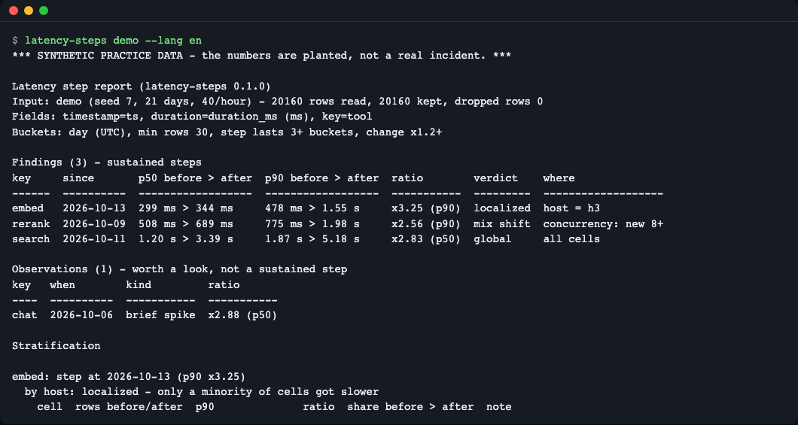
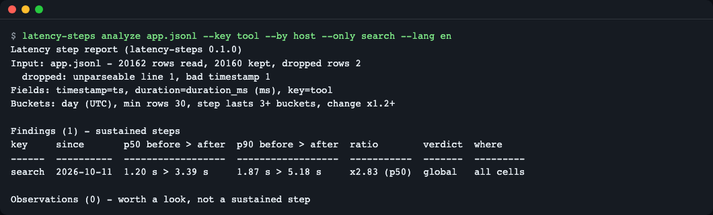
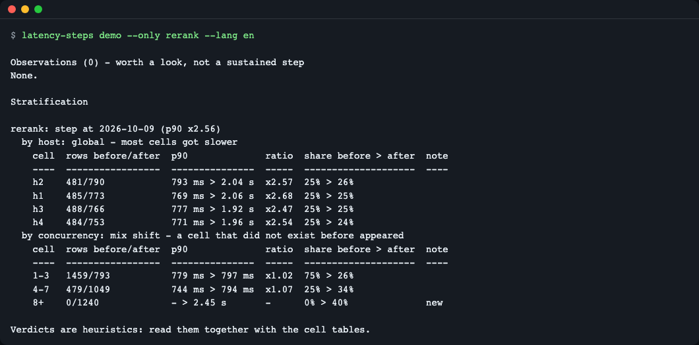
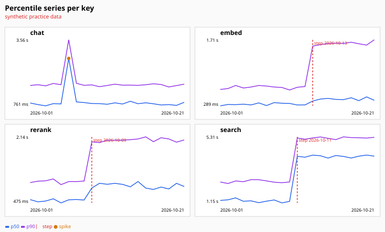
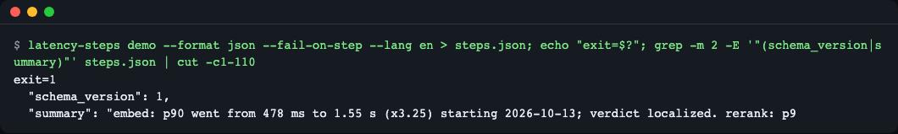
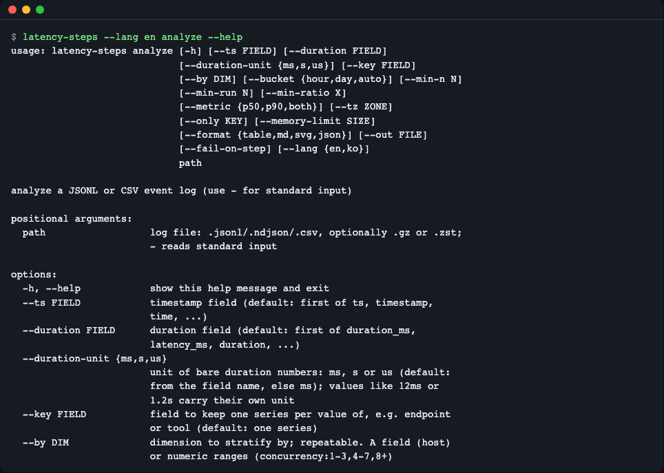
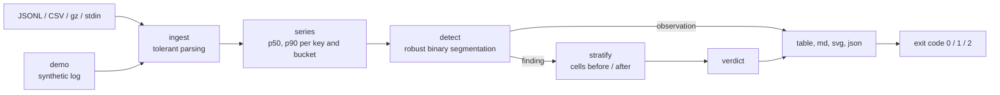

# latency-steps

**English** | [한국어](README.ko.md)

Someone says "it got slower". `latency-steps` reads your raw JSONL or CSV event log offline and tells you, per key (tool, endpoint, model), **when** latency stepped up and whether that step is **one host**, a **shift in the load mix**, or **everything**. It builds p50/p90 time series with DuckDB, finds sustained steps with a small pure-Python change-point detector, and then splits the windows before and after each step by the dimensions you name.


*One command on built-in synthetic practice data: three sustained steps (findings) and one one-day spike (observation).*

## Who it is for
- You run a backend or an agent and keep tool-call, API or model-response logs as files, and you get "it feels slower since last week".
- You want to know whether a slowdown is a bad host, a change in what kind of traffic arrives, or a global change, before the meeting.
- You want a nightly CI job that fails when a new latency step appears.

## Install

Needs Python 3.11 or newer (DuckDB 2.0 requires it) and [uv](https://docs.astral.sh/uv/).

```bash
curl -LsSf https://astral.sh/uv/install.sh | sh     # installs uv (macOS / Linux)
git clone https://github.com/LeeGyeongPil/latency-steps
cd latency-steps
uv tool install .                                    # puts `latency-steps` on your PATH
latency-steps --version
```

```text
latency-steps 0.1.0
```

On a minimal Linux image you also need `git` and `curl` (and `ca-certificates`). The only runtime dependency is `duckdb`.

Or run straight from the clone without installing: `uv run latency-steps demo`.

## Quick start: the practice mode

`demo` is a **practice (mock) mode**: it writes a seeded synthetic log (4 keys x 4 hosts x 21 days, about 20,000 rows) and analyzes it through the same code path as a real file. The numbers are planted, not a real incident, and the screen says so. Nothing else is faked, and no network or API key is involved.

```bash
latency-steps demo --lang en
```

```text
*** SYNTHETIC PRACTICE DATA - the numbers are planted, not a real incident. ***

Latency step report (latency-steps 0.1.0)
Input: demo (seed 7, 21 days, 40/hour) - 20160 rows read, 20160 kept, dropped rows 0
Fields: timestamp=ts, duration=duration_ms (ms), key=tool
Buckets: day (UTC), min rows 30, step lasts 3+ buckets, change x1.2+

Findings (3) - sustained steps
key     since       p50 before > after  p90 before > after  ratio        verdict    where
------  ----------  ------------------  ------------------  -----------  ---------  -------------------
embed   2026-10-13  299 ms > 344 ms     478 ms > 1.55 s     x3.25 (p90)  localized  host = h3
rerank  2026-10-09  508 ms > 689 ms     775 ms > 1.98 s     x2.56 (p90)  mix shift  concurrency: new 8+
search  2026-10-11  1.20 s > 3.39 s     1.87 s > 5.18 s     x2.83 (p50)  global     all cells

Observations (1) - worth a look, not a sustained step
key   when        kind         ratio
----  ----------  -----------  -----------
chat  2026-10-06  brief spike  x2.88 (p50)
```

(The full report continues with one evidence table per finding and dimension.) How to read it:

- **Findings** are steps that lasted at least 3 buckets and changed p50 or p90 by at least x1.2. `since` is the first bucket at the new level.
- `search` got slower everywhere (`global`), `embed` only on host `h3` (`localized`; its overall p50 barely moves, which is why the p90 column matters), `rerank` because a new kind of traffic appeared (`mix shift`).
- **Observations** are things that went back (`chat` was slow for one day only) or went the other way. They are shown but never counted as a step.

## Analyze your own logs

```bash
latency-steps analyze app.jsonl --key tool --by host --by concurrency:1-3,4-7,8+
```

| Option | What it does | Example |
|---|---|---|
| `path` | JSONL or CSV file, `.gz` / `.zst` also work, `-` reads standard input | `app.jsonl.gz`, `-` |
| `--ts FIELD` | Timestamp field. Default: the first of `ts`, `timestamp`, `time`, ... that exists | `--ts time` |
| `--duration FIELD` | Latency field. Default: the first of `duration_ms`, `latency_ms`, `duration`, ... | `--duration elapsed` |
| `--duration-unit ms\|s\|us` | Unit of bare numbers (guessed from the field name, else ms). Values like `12ms` or `1.2s` are read as written | `--duration-unit s` |
| `--key FIELD` | One series per value of this field. Default: a single series | `--key endpoint` |
| `--by DIM` | Dimension to stratify by, repeatable: a field, or numeric ranges `field:1-3,4-7,8+` | `--by host` |
| `--bucket hour\|day\|auto` | Time bucket (`auto` = day when the log spans 14+ days) | `--bucket hour` |
| `--min-n N` | Buckets with fewer rows are left out of the series (default 30) | `--min-n 50` |
| `--min-run N` | A step must last this many buckets (default 3) | `--min-run 4` |
| `--min-ratio X` | A step must change p50 or p90 by this factor (default 1.2) | `--min-ratio 1.5` |
| `--metric p50\|p90\|both` | Which percentile series to inspect (default both) | `--metric p90` |
| `--tz ZONE` | Bucket time zone (default UTC) | `--tz Asia/Seoul` |
| `--only KEY` | Analyze only this key, repeatable | `--only search` |
| `--memory-limit SIZE` | DuckDB memory cap (default 1GB); raise it for very large inputs | `--memory-limit 4GB` |
| `--format table\|md\|svg\|json`, `--out FILE` | Output format and destination | `--format md --out report.md` |
| `--fail-on-step` | Exit with code 1 when a step is found | |
| `--lang en\|ko` | Screen language | `--lang ko` |

`latency-steps demo` takes the same output options plus `--seed`, `--per-hour` and `--save FILE` (keep the synthetic log as a JSONL file to experiment on).

### Messy logs are reported, not fatal

Broken lines, unparseable timestamps and values like `"12ms"` do not stop the run. Values are read as text and converted tolerantly; rows that cannot be interpreted are counted and shown. Here two bad lines were appended to a saved demo log:

```bash
latency-steps demo --save app.jsonl > /dev/null
printf 'not json at all\n{"ts":"yesterday-ish","duration_ms":"12ms","tool":"search","host":"h1","concurrency":2}\n' >> app.jsonl
latency-steps analyze app.jsonl --key tool --by host --only search --lang en | head -3
```

```text
Latency step report (latency-steps 0.1.0)
Input: app.jsonl - 20162 rows read, 20160 kept, dropped rows 2
  dropped: unparseable line 1, bad timestamp 1
```


*Rows that could not be used are counted with a reason instead of silently vanishing.*

## How it decides

Think of a body-temperature chart. One hot afternoon is not a fever; a week at a higher level is.

1. **Percentiles, not averages.** For each key and time bucket it computes p50 (the typical request) and p90 (the slow tail). A regression that hits one host in four barely moves p50 but shows up in p90. Buckets with fewer than `--min-n` rows are skipped and reported, so a quiet night cannot fake a step.
2. **Change points on a log scale.** The series is split recursively where the medians on the two sides differ most, measured in units of how noisy the series is. Median-based, so a single odd day does not become a step. The log scale means "twice as slow" counts the same at 100 ms and at 3 s.
3. **Steps versus spikes.** Instead of tuning a penalty number, you say how long (`--min-run`) and how big (`--min-ratio`) a change must be. Short or reverting changes become observations.
4. **Stratify.** For every finding the windows before and after are split by each `--by` dimension, and each cell gets its row counts, before/after value, ratio and share of traffic.

## Reading the verdict

| Verdict | Meaning | Look at |
|---|---|---|
| `localized` | Only a few cells got slower | the host, region or version in the `where` column |
| `mix_shift` | Cell ratios are flat, or a cell that did not exist before appeared: the traffic changed, not the code path's speed | the `share before > after` column and `new` notes |
| `global` | At least 80% of cells got slower | a change that touches everything: deploy, dependency, shared service |
| `inconclusive` | Cells are too thin or two cells moved together | the table; collect more data |

With several `--by` dimensions the overall verdict is chosen in the order localized > mix shift > global > inconclusive. The `rerank` story in the demo is Simpson's paradox: judged by host every host is about x2.5 slower, yet by concurrency the old cells are flat and a cell `8+` that had no rows before carries the whole step.

```bash
latency-steps demo --only rerank --lang en
```

```text
  by concurrency: mix shift - a cell that did not exist before appeared
    cell  rows before/after  p90              ratio  share before > after  note
    ----  -----------------  ---------------  -----  --------------------  ----
    1-3   1459/793           779 ms > 797 ms  x1.02  75% > 26%
    4-7   479/1049           744 ms > 794 ms  x1.07  25% > 34%
    8+    0/1240             - > 2.45 s       -      0% > 40%              new
```


*The verdicts are heuristics. Always read them together with the cell tables.*

## Reports

- `--format md --out report.md` writes Findings, Observations and the stratification tables as Markdown.
- `--format svg --out chart.svg` writes one small panel per key with p50 and p90 lines, a vertical line at each step and a dot on spikes.

```bash
latency-steps demo --format svg --out chart.svg --lang en
```


*The SVG report of the demo log.*

- `--format json` writes a stable structure with `"schema_version": 1`. Keys and verdict codes are always English; only the `summary` strings follow `--lang`.

## CI usage

Exit codes: `0` ok, `1` a step was found (only with `--fail-on-step`), `2` input or option error.

```bash
latency-steps demo --format json --fail-on-step --lang en > steps.json; echo "exit=$?"; grep -m 2 -E '"(schema_version|summary)"' steps.json | cut -c1-110
```

```text
exit=1
  "schema_version": 1,
  "summary": "embed: p90 went from 478 ms to 1.55 s (x3.25) starting 2026-10-13; verdict localized. rerank: p9
```


*In CI, replace `demo` with `analyze nightly.jsonl --key tool` and let the exit code fail the job.*

```yaml
- run: latency-steps analyze nightly.jsonl --key tool --by host --format json --fail-on-step > steps.json
```

## Language

The screen is available in English and Korean. Priority: `--lang en|ko` > `LATENCY_STEPS_LANG` > `LC_ALL` / `LC_MESSAGES` / `LANG` (a value starting with `ko` selects Korean, anything else English). Help text, tables, Markdown and SVG labels follow it.

```bash
LATENCY_STEPS_LANG=ko latency-steps demo
```


*`latency-steps --lang en analyze --help`. The same screen exists in Korean.*

## How it works



Ingest and the percentile series run in DuckDB; detection and verdict rules are plain Python standard library (`math`), no numpy, scipy or ruptures.

## Limits

- Verdicts are heuristics read from cell tables. Two hosts degrading together, or thin cells, give `inconclusive`.
- A regression diluted across a large share of traffic is only caught through the p90 series. Per-dimension detection (`--detect-by`) is not in 0.1.0.
- Hourly buckets of a multi-day outage appear as a step up and a step down; use `--bucket day` for day-level questions.
- `.zst` input relies on DuckDB reading it and is not covered by an automated test.
- The field-name check for JSONL looks only at the first 50 non-blank lines, so a field that first appears later in the file is reported as missing; reorder the file or pass names that appear early.
- It answers "when" and "where", not "why". Pair the result with your deploy and config history.

## When to use it

- Good fit: you have raw event logs as files, you do not know when a slowdown started, and you want a first narrowing by host, region or load level without a server.
- Other tools for other jobs: change-point detection on already-aggregated benchmark metrics in a CI store, see [Apache Otava](https://github.com/apache/otava); change-point algorithms as a library, see [ruptures](https://github.com/deepcharles/ruptures); interactive exploration of live traces in a hosted service, see [Honeycomb BubbleUp](https://docs.honeycomb.io/investigate/analyze/identify-outliers/); browsing and querying log files, see [lnav](https://github.com/tstack/lnav).

## Troubleshooting

| Symptom | Cause | Fix |
|---|---|---|
| An installation error about the Python version | DuckDB 2.0 needs Python 3.11+ | Use `uv python install 3.13` or any 3.11+ interpreter |
| `error: input file not found` and exit code 2 | Wrong path | Check the path, or pass `-` to read standard input |
| `error: could not find the nosuch field. Fields seen: ts, duration_ms, ...` and exit code 2 | A `--key`, `--by`, `--ts` or `--duration` name does not exist in the file (checked in the first 50 non-blank lines of JSONL, and in the CSV header) | Use one of the names listed after `Fields seen:` |
| `error: the file is empty: no non-blank lines found.` and exit code 2 | The file has no content, for example a log rotation just happened | Point to the right file |
| No findings on a log you know regressed | Too few rows per bucket, or the step is shorter than `--min-run` buckets | Lower `--min-n`, use `--bucket hour`, or lower `--min-run` |
| Many "dropped rows" | The timestamp or duration field was picked wrongly | Pass `--ts` and `--duration` explicitly; see the `dropped:` reason line |
| Verdict `inconclusive` | Cells too thin or two cells moved together | Read the cell tables, add a better `--by` dimension |

## Development

```bash
uv sync
uv run pytest -q
```

```text
46 passed
```

Bugs and ideas are welcome as issues. Changes are listed in [CHANGELOG.md](CHANGELOG.md).

## More reading

- Apache Otava (change-point detection in performance results): https://github.com/apache/otava
- ruptures (change-point detection in Python): https://centre-borelli.github.io/ruptures-docs/
- DuckDB `quantile_cont`: https://duckdb.org/docs/2.0/sql/functions/aggregates.html


## License

MIT. All demo data is generated by the built-in generator.
